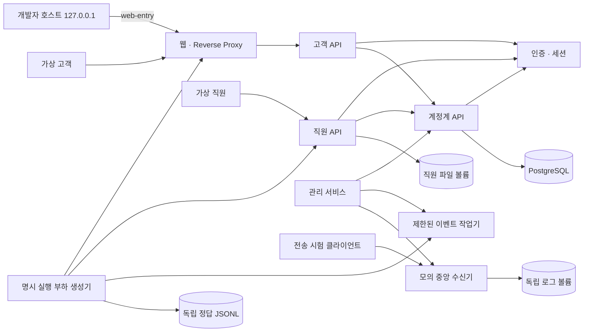

# 가상 은행망 구조

이 디렉터리는 `llooggeerr` 수집기 자체가 아니라 수집기를 검증할 은행 업무·이벤트 시험장이다. 이전 프로젝트 소스는 사용하지 않는다. 모든 계좌와 사용자는 가상 데이터이며 외부 금융기관에 요청하지 않는다.

## 업무 흐름

화살표는 애플리케이션의 허용된 호출 방향이다. Docker 브리지는 방향성 방화벽이 아니므로 같은 네트워크의 양쪽 컨테이너는 서로 TCP 연결을 시도할 수 있다. 인증·권한 검사는 네트워크 배치와 별도로 적용한다. 정확한 연결 구성은 [접근 표](network-matrix.md)와 `compose.yaml`이 기준이다.

## 서비스와 데이터

| 서비스 | 역할 | 영속 상태 |
|---|---|---|
| web | 고정된 고객 API 경로만 전달하는 Reverse Proxy, 고객 웹 화면 | 없음 |
| customer | 고객 세션 확인, 본인 계좌·이체 요청 처리 | 계정계에 위임 |
| auth | 고객·직원 인증, 폐기 가능한 불투명 세션 | SQLite 세션 DB |
| core | 계좌 소유권, 잔액, 이체 멱등성·트랜잭션 | PostgreSQL |
| employee | 역할에 따른 고객 조회·보고서·파일·고정 작업 | 직원 파일, 계정계 작업 이력 |
| db | 가상 고객·계좌·거래·직원 역할·작업 이력 | 전용 PostgreSQL 볼륨 |
| events | 파일·프로세스·권한·소켓·제한 자원 시험 | 작업 파일; 디스크 고갈은 전용 tmpfs |
| receiver | 수신·저장 상태, 재전송·중복·응답 장애 시험 | SQLite 수신 DB |
| manager | 허용된 내부 상태 조회 | 없음 |
| customer-client / employee-client | 각 망에서 독립 테스트 요청 | 없음 |
| log-forwarder | 로그 수집망의 전송 시험 클라이언트 | 없음 |
| load | 명시 실행 시에만 유한한 업무·이벤트 부하 생성 | `results-data` 볼륨의 독립 정답·성능 결과 |

인증용 비밀값은 최초 구동 때 생성하여 전용 볼륨에 저장한다. 소스 코드와 버전 관리에는 넣지 않는다. 이 설계는 개발 시험용이며 실제 은행의 인증·비밀 관리 체계를 대신하지 않는다.

부하 원본은 컨테이너의 `/results`에 연결된 UID 10001 소유 named volume에 저장한다. Linux 체크아웃 디렉터리의 사용자 권한에 의존하지 않는다. `scripts/lab.py`의 load/test 종료 시 호스트 `results/`로 복사하며, Docker Compose나 테스트 러너를 직접 호출한 경우 `python3 scripts/lab.py export`를 실행한다. 이 내보내기는 볼륨의 원본을 삭제하지 않는다.

## 거래 정합성

금액은 정수 센트 단위로 처리한다. 계정계는 PostgreSQL 트랜잭션 안에서 계좌를 일정한 순서로 잠그고 출금·입금을 함께 반영한다. 같은 요청 ID에는 같은 요청 내용만 허용하며 이미 처리한 요청의 재전송은 잔액을 다시 변경하지 않는다. 요청 ID가 같고 내용이 다르면 충돌로 거절한다. 통합 테스트는 두 고객의 동시 반대 방향 이체, 동시 중복 요청, 부족 잔액, 재시작 이후 재전송을 확인한다.

## 실행 경계

기본 실행은 은행 업무에 필요한 서비스 위주로 유지하고 테스트·로그·부하는 Compose profile로 추가한다. CPU·메모리·PID 제한은 `compose.yaml`에서 확인할 수 있다. 이 값은 개발 장비 보호를 위한 초기 설정이며 수집기의 성능 합격 기준이 아니다. 기본 구동만으로 부하·장애·자원 고갈 시험을 시작하지 않는다.

호스트에 공개하는 웹 포트는 `127.0.0.1`만 사용한다. DB·계정계·관리·수신기 포트는 호스트에 게시하지 않는다. 업무 컨테이너는 비 root로 실행하고 Docker socket·privileged 권한을 사용하지 않는다. 호스트 CLI만 명시적인 서비스 재시작과 시험용 네트워크 단절을 수행한다.

웹 포트를 실제로 게시하기 위해 `web`만 비내부 브리지 `web-entry`에 추가 연결한다. 고객·직원·부하·DB·로그 네트워크는 계속 `internal: true`다. `web-entry`는 웹 컨테이너의 외부 송신 경로를 만들 수 있으므로 완전한 외부 통신 차단이라고 주장하지 않는다. Reverse Proxy는 고정된 내부 고객 API만 전달하며 시험 도구는 외부 목적지를 받지 않는다. 더 강한 외부 송신 차단이 필요하면 호스트별 방화벽 정책을 별도로 적용하고 검증해야 한다.

## 관측 출처

애플리케이션 감사 기록, PostgreSQL 기록, Docker 런타임 기록, 커널 이벤트, 향후 수집기 자체 진단은 서로 다른 출처다. 하나의 이체가 한 개의 syscall 또는 한 개의 eBPF 이벤트라고 가정하지 않는다. 부하 생성기의 정답은 실제 요청 시도와 반환값을 기준으로 독립 작성한다. 수집기 지표는 연결되기 전까지 측정 불가로 남긴다.
