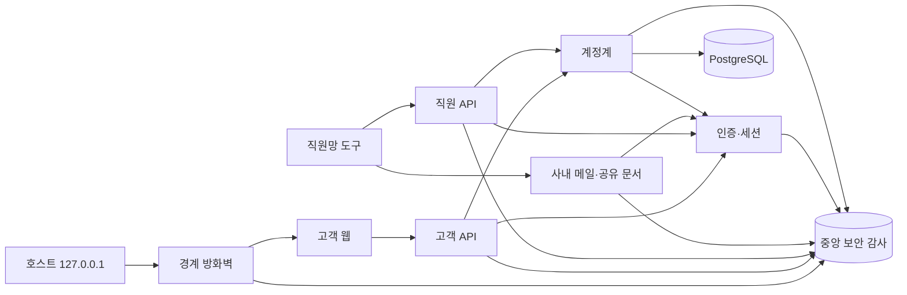

# 회사망 구조

실선은 애플리케이션의 호출 경로입니다. `security`는 기존 내부 업무망에 연결되지만 DB 전용망에는 연결되지 않습니다. 감사 전송을 위한 별도 브리지를 늘리지 않아 여러 복사본을 실행하기 쉽습니다.

`firewall`은 호스트에 게시되는 유일한 서비스입니다. 웹 서버는 내부 `edge-web`망에만 연결됩니다. 따라서 호스트에서 고객 API로 가는 요청은 경계 정책을 거칩니다. 방화벽 컨테이너는 허용된 HTTP 경로와 메서드를 검사하는 애플리케이션 게이트웨이입니다. 같은 Docker 브리지의 연결을 양방향으로 막는 일반 IP 방화벽은 아닙니다.

`office`에는 직원과 운영자가 함께 쓰는 메시지·문서 기능이 있습니다. 직원 개인 파일과 보고서는 `employee`의 별도 볼륨에 둡니다. `core`만 DB 네트워크에 연결되고, `security`는 DB와 별도 볼륨에 감사 기록을 저장합니다.

모든 영속 데이터는 Docker named volume에 보관합니다. 애플리케이션 컨테이너는 비 root UID, 읽기 전용 루트 파일시스템, capability 제거, `no-new-privileges`로 실행합니다. PostgreSQL 공식 이미지는 자신의 초기화 절차에 따라 실행합니다.

외부 로거나 SIEM은 이 회사망의 필수 구성요소가 아닙니다. 프로젝트에 맞게 `security`의 내부 조회 API, 업무 서비스 stdout, PostgreSQL 감사, Docker 런타임 사건을 별도 출처로 수집할 수 있습니다. 이 데이터는 행위 시도와 업무 완료 여부를 구분해 조사할 때 사용합니다.
